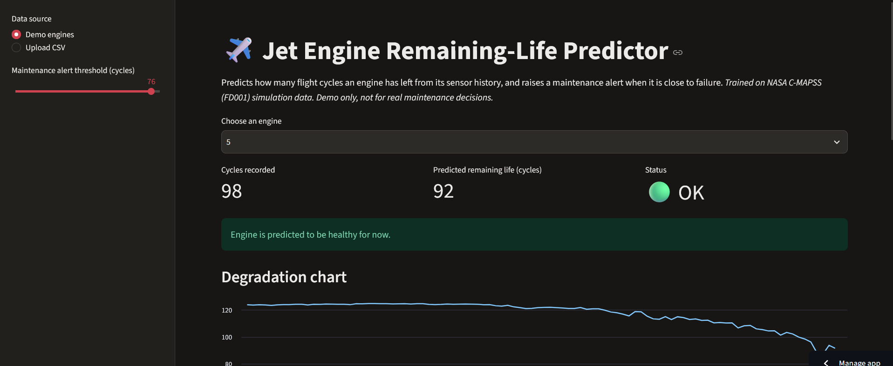

# Jet Engine Remaining-Life Prediction

**Predicts how many flight cycles a jet engine has left before failure from its sensor readings, and raises a maintenance alert before it becomes critical.**

## 🔗 Live demo

**[Try the app here](https://jet-engine-remaining-life-prediction-drwnkwjbs9czxswcfbic9t.streamlit.app/)**



---

## The problem

Airlines usually service engines on fixed schedules. That either wastes healthy parts (too early) or risks in-flight failure (too late). This project predicts an engine's **Remaining Useful Life (RUL)** so maintenance can be scheduled when it is actually needed. The same approach applies to factories, trains and power plants.

## What the app does

- Pick an engine (demo data) or upload your own sensor history as a CSV
- See the predicted remaining life in cycles
- View the degradation chart and individual sensor trends
- Set an alert threshold: the app flags **MAINTENANCE NEEDED** when predicted RUL falls below it

## Results

Evaluated on the untouched NASA test set: 100 engines, one prediction per engine at its last recorded cycle.

| Model | RMSE (cycles) | MAE (cycles) | R² | NASA score ↓ |
|---|---|---|---|---|
| Baseline (mean RUL) | 41.94 | 34.83 | -0.10 | 33,354 |
| Ridge | 21.24 | 16.48 | 0.72 | 1,390 |
| Hist Gradient Boosting | 17.68 | 12.55 | 0.81 | 872 |
| **Random Forest (final)** | **17.66** | 12.68 | **0.81** | **598** |

The final model was chosen by cross-validated RMSE (GroupKFold by engine): Random Forest 16.17, Hist Gradient Boosting 16.41, Ridge 19.80. The Random Forest cuts the baseline's RMSE by about 58%.

**Maintenance alert** (an engine is "at risk" if its true RUL is below 30 cycles; 25 of the 100 test engines are):

| Alert if predicted RUL < | Precision | Recall | Alerts raised |
|---|---|---|---|
| 30 | 0.94 | 0.68 | 18 |
| 35 | 0.95 | 0.80 | 21 |
| **40 (app default)** | **0.95** | **0.84** | 22 |
| 50 | 0.76 | 0.88 | 29 |

A threshold of 40 catches 84% of engines that are within 30 cycles of failure, and 95% of its alerts are real. Raising it to 50 catches slightly more (88%) but costs precision (76%).

## Approach

1. **Data:** NASA C-MAPSS turbofan degradation, subset **FD001** (100 training engines run to failure: 20,631 cycles; 100 test engines: 13,096 cycles).
2. **Target:** RUL = last cycle of the engine minus the current cycle, capped at 125 (the standard piece-wise linear RUL for this benchmark).
3. **EDA:** engine lifetimes (128 to 362 cycles, mean 206), sensor drift near failure, correlations. 6 constant sensors were removed, leaving 15.
4. **Features (46):** engine age (`cycle`), the 15 sensors, and per-engine rolling mean and std (10-cycle window) of each sensor. Rolling features use only past readings, so there is no leakage. Scaling is done inside a scikit-learn `Pipeline`.
5. **Validation:** `GroupKFold` by engine, so rows of one engine never appear in both train and validation folds. Hyperparameters tuned with `RandomizedSearchCV` on training data only.
6. **Models:** Ridge, Random Forest and Histogram Gradient Boosting vs. a mean baseline.
7. **Metrics:** RMSE, MAE, R² and the NASA asymmetric score, which penalizes late predictions more than early ones.
8. **Deployment:** final pipeline saved with `joblib` and served with Streamlit.

## Key insights

- **Engines fail at very different ages** (128 to 362 cycles), so a fixed schedule must be set for the shortest-lived engines and wastes life on the rest.
- **6 of 21 sensors are constant** and carry no information. The rest drift as the engine degrades, and rolling averages help because raw readings are noisy.
- **Engine age (`cycle`) is the most important feature**, followed by smoothed readings of sensors s4, s9, s11, s15 and s14 (permutation importance).
- **The model is slightly optimistic near failure.** For engines within 30 cycles of failure, the mean error is +8.4 cycles (it predicts a bit more life than remains), although MAE there is 8.9 cycles. Overall, 60% of predictions are later than the truth. For safety, use a higher alert threshold.
- **Worst misses** are engines whose degradation looks atypical, e.g. engine 41 (true RUL 18, predicted 62).

## Repository structure

```
├── app.py                 # Streamlit app
├── rul_pipeline.joblib    # trained scikit-learn pipeline (Random Forest)
├── meta.json              # feature list and settings used by the app
├── demo_engines.csv       # sample sensor histories for the demo
├── requirements.txt       # pins scikit-learn==1.6.1
├── jet-engine-remaining-life-prediction.ipynb   # full analysis
└── README.md
```

## CSV format for uploads

Required columns: `unit`, `cycle`, `s1` ... `s21` (same format as `demo_engines.csv`, no missing sensor values).

## Limitations

- Simulated data (FD001) with one operating condition and one fault mode; real engines are messier.
- Only 100 training engines, so estimates have high variance.
- RUL is capped at 125 cycles, so the model cannot say how healthy an engine is beyond that.
- The model relies heavily on engine age, and needs a few cycles of history per engine.
- Errors reach 40-55 cycles on some engines, so predictions should support a decision, not replace inspection.
- **Demo only. Not for real maintenance decisions.**

## Data source

A. Saxena and K. Goebel (2008). *Turbofan Engine Degradation Simulation Data Set*, NASA Prognostics Data Repository.
Kaggle copy: https://www.kaggle.com/datasets/behrad3d/nasa-cmaps

## Tools

Python · pandas · scikit-learn · matplotlib · seaborn · joblib · Streamlit
